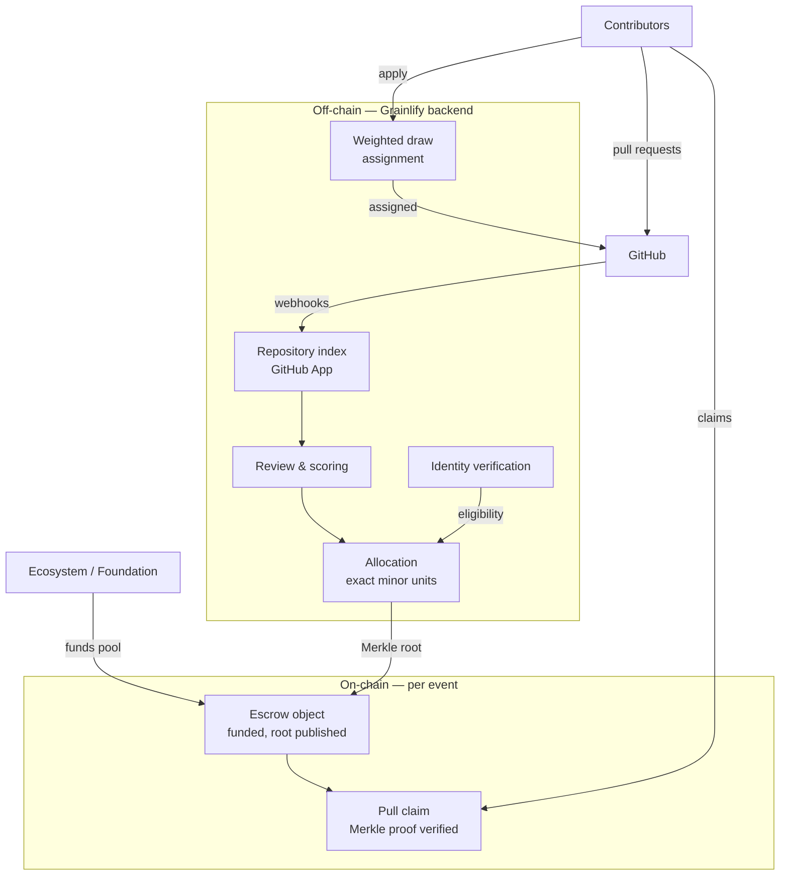
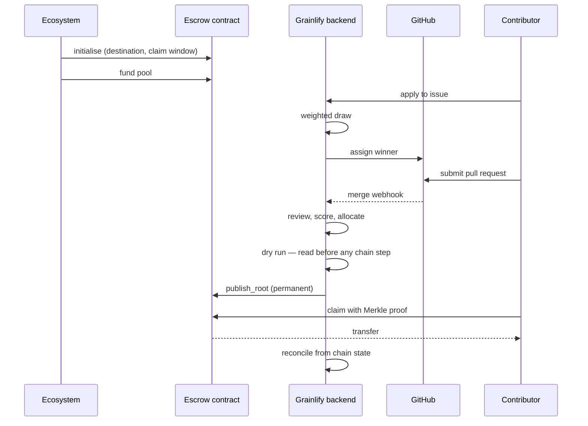
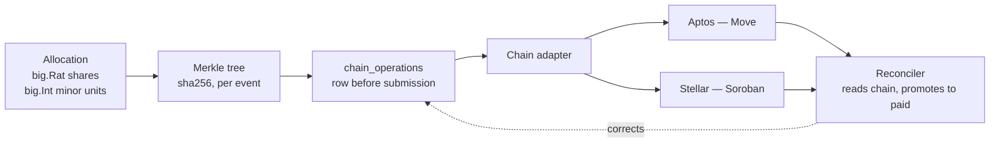

# Grainlify

**Grant execution infrastructure for open source.** Ecosystems fund the work; Grainlify decides who gets to do it, judges what was delivered, and lets contributors claim what they earned — verifiably, on-chain.

> **A reward you can calculate in advance is a reward you can farm.**

That one sentence explains most of the design decisions below.

---

## Honest status

This README marks every capability with where it actually stands. Nothing here is aspirational without saying so.

| | Meaning |
|---|---|
| **Live** | Running in production, used by real people today |
| **Built** | Written, tested, not yet wired into a path anyone travels |
| **Designed** | Argued through and specified; no implementation yet |

**As of 18 August 2026: no funded event has run, and nothing has been paid out on any chain.** Everything about payouts below is Built or Designed. We would rather say that than let a reader assume otherwise.

---

## 1. The problem

Ecosystems allocate real money to open source. The allocation part works. The execution part does not:

- Funding is managed off-chain, with no verifiable link between money spent and work delivered
- Maintainers distribute rewards manually, which does not scale and is not auditable
- Contributors must trust that they will be paid fairly, with no way to check
- Reward rules are either undisclosed or precise enough to game

Discovery and coordination are largely solved — OnlyDust, GrantFox and Drips Wave all do this well. **Execution is not.**

## 2. What Grainlify does differently

Most platforms publish what a contribution is worth before the work starts: fixed bounties, point shares, first-come assignment. Anything calculable in advance is farmable, and those models reward speed and volume rather than quality.

Grainlify inverts three things:

**Assignment is a weighted draw, not first-come** — inside a funded event. Applying earlier does not help. Applying to more issues does not improve your odds on any one of them.

**Rewards are decided after the work is judged**, not published in advance.

**All 102 allocation parameters are public.** Knowing exactly how you are weighted still gives you nothing to farm, because every input is something you can only change by doing good work.

---

## 3. Two modes, and an important scope note

**Inside GrainHack** — a funded event. An ecosystem funds the pool, so assignment must be unfarmable. Issues carry rewards, assignment runs through the weighted draw, and payouts settle on-chain.

**Outside GrainHack** — ordinary open-source contribution. No money moves, so maintainers assign issues themselves, exactly as they would anywhere else. This is intentional. The draw exists to protect funded assignment; where there is nothing to farm, there is nothing to protect against.

Anywhere our documentation or copy describes the draw, it is scoped to GrainHack. If you find a place where it is not, that is a bug and we want to hear about it.

---

## 4. System overview

Note the direction of the last arrow. **Contributors claim; we never push funds to an address.** No batch transfer, no admin-initiated payment to a user. This is a deliberate constraint, not an implementation detail.

---

## 5. What lives where

### Off-chain

Repositories and issues, applications and assignments, review outcomes, contributor rankings, identity verification status, and the allocation computation.

Kept off-chain for flexibility, cost, and — for identity data — because it does not belong on a public ledger.

### On-chain

Per event: the escrow balance, the published Merkle root, claimed markers, and the claim deadline.

**No identities, no GitHub data, no scores.** A leaf commits to an address and an amount. Nothing else about a person reaches the chain.

**The chain is the system of record.** Where the database and the chain disagree, the chain wins and the database is corrected.

---

## 6. GrainHack lifecycle

### The weighted draw

Weight starts at 1.0 and is multiplied by:

| Factor | Effect |
|---|---|
| Fit for that specific issue | ×2.0 / ×1.0 / ×0.25 |
| Difficulty above your level | ×0.5 |
| Prior completion | ×1.5 |
| First-ever application | ×1.5 |
| Each prior abandonment | ×0.5, compounding |

**Explicitly excluded**, and enforced by never being read: total pull requests, merge rate, follower count, repository stars, total contributions, and the quality of your application text.

The newcomer weight is anchored on prior *assignments*, not prior *applications* — specifically so that applying more cannot help you.

### Reward decisions

Rewards are retroactive and quality-gated. AI-assisted judging is **built and deliberately disabled**: our own calibration measured 70–75% agreement against a 60% always-accept baseline, which is not good enough to decide who gets paid. It stays off until it is clearly better than not having it.

---

## 7. Payout architecture

**The only chain-specific component is the contract and a thin adapter.** Allocation, the Merkle tree, operation records, reconciliation, claim state and idempotency are all chain-agnostic — which is why a second chain is a second contract rather than a second project.

Key properties:

- **Exact arithmetic.** Shares in `big.Rat`, payouts in `big.Int` minor units. No floating point anywhere between database and leaf. Lines are asserted to sum to the pool exactly; the remainder rule is largest fractional remainder first, ties broken by lowest user id — arbitrary by design, because determinism matters more than cleverness at 0.000001 units.
- **Dry run first.** The full allocation is computed and read by a human before anything touches a chain. `publish_root` is permanent.
- **A row before submission.** Only the reconciler, reading chain state, may mark anything paid.
- **Cross-language vectors.** The Merkle leaf and tree are pinned by shared test vectors so the Go builder and the on-chain verifier cannot silently diverge. Every implementation is mutation-tested against those vectors.

### Sweep — Designed

Two functions, never one:

**Residue** (`balance − root_total`) belongs to nobody and no leaf can claim it, so it sweeps immediately.

**Unclaimed entitlements** belong to named people who have not turned up, and carry the full claim window. The destination is fixed at initialisation and is never a parameter on the sweep call. The deadline can be **extended but never shortened** — so the admin power is to give more time, never to cut anyone off.

---

## 8. Identity and compliance

Identity verification runs off-chain through a third-party provider. Verification status gates eligibility; **no identity data ever reaches the chain.**

Verification outcomes carry plain-language reasons back to the contributor so a failure is actionable rather than a dead end. Fraud-signal categories are deliberately never explained to the person they concern.

---

## 9. Where Grainlify sits

| | Discovery | Coordination | Unfarmable assignment | Retroactive rewards | On-chain claims |
|---|---|---|---|---|---|
| Traditional grant programmes | Manual | Manual | — | Sometimes | — |
| Contribution platforms | Yes | Yes | — | — | Varies |
| **Grainlify** | Yes | Yes | Yes, in funded events | Yes | Designed, not yet run |

We are not the first into this space and we do not claim to be. OnlyDust proved contributors show up when work is discoverable and reputation travels with them. GrantFox showed maintainers need a real surface rather than a bounty board. Drips Wave proved recurring cycles build habit. We took a different bet on the one thing all three leave calculable in advance.

---

## 10. Design principles

- **Escrow first** — funds are locked before work begins
- **Pull, never push** — contributors claim; the platform never sends
- **The chain is the system of record** — the database is a cache of it
- **Minimal on-chain logic** — contracts are vaults and verifiers, not business rules
- **Publish the parameters** — auditable without being predictable
- **Never overstate readiness** — status labels stay in the copy

---

## 11. What Grainlify is not

- Not a DAO
- Not a marketplace
- Not a GitHub replacement
- Not custodial — we never hold contributor funds
- Not a payments platform outside funded events

---

## 12. Current scale

As of 18 August 2026. The index grows continuously, so every figure carries a date.

| | |
|---|---|
| Indexed repositories (live, verified) | 167 |
| Non-fork | 135 |
| Distinct GitHub owners | 33 |
| Owners with a complete project profile | 25 |
| Indexed issues | 5,591 |
| Merged pull requests indexed | 3,707 across 1,028 distinct authors |
| Registered accounts | 131 |
| Founding contributor pool members | 38 |
| Funded events run | 0 |
| Payouts made, any chain | 0 |

Forks are excluded from ranking and from every project surface — a fork is a repository the contributor controls, which would otherwise make the leaderboard farmable on the one mechanism we claim is not.

---

## 13. Repositories

| Repository | Contents |
|---|---|
| `Grainlify-Backend` | Go API, GitHub App integration, allocation, Merkle tree, chain adapters |
| `Grainlify-Frontend` | React / Vite application |
| `Grainlify-Docs` | Public documentation |
| `Aptos-Contracts` | Move contracts — escrow, root publication, pull claims |
| `Stellar-Contracts` | Soroban implementation of the same model |
| `Grainlify-Specs` | Allocation parameters and protocol specifications |

---

## 14. Roadmap

**Now** — Aptos testnet: escrow, root publication, and a complete end-to-end claim by a real contributor.

**Next** — Soroban against the same chain-agnostic core.

**Then** — the first funded GrainHack event, end to end.

We will announce the first real payout when it happens, with the transaction, and not before.

---

## 15. Contributing and contact

Issues and pull requests are welcome across all repositories.

- Website — [grainlify.com](https://grainlify.com)
- Documentation — [docs.grainlify.com](https://docs.grainlify.com)
- Telegram — [@Grainlify](https://t.me/Grainlify)
- X — [@Grainlify](https://x.com/Grainlify)

If you find a claim in our documentation, product copy or this README that is not true of the code, please open an issue. We have corrected several this month and we would rather hear it from you than not at all.
